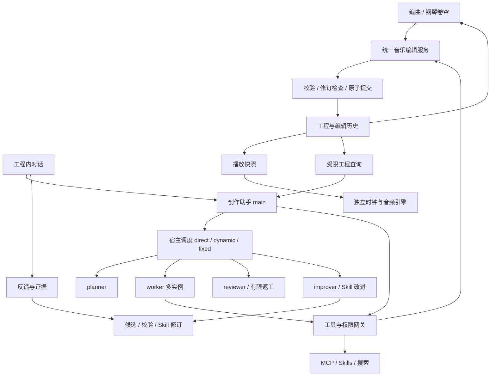

# IceTudio 架构

更新：2026-10-28。本文为目标设计，不是现有功能清单；交付状态以[实施计划](../IMPLEMENTATION_PLAN.md)为准。原设计保存在[历史档案](history/icepick-architecture-2026-10-16.md)。P0 的符号、存储和接口范围以[执行契约](p0-refactor-contract.md)为准。

## 1. 产品边界

IceTudio 是 AI native 音乐创作软件。音乐工程是工作对象，编曲视图和钢琴卷帘是主要编辑界面；Agent 与用户共享工程模型、编辑命令和撤销历史。不连接模型也能编辑、试听和保存，连接后可以交替手工与自然语言创作。

首版聚焦 MIDI 创作和可用试听。MCP、Skills、联网搜索和反馈驱动 Skill 改进保留为正式能力。移除通用场景模板、Profile 管理/分享/生成产品和独立长期记忆。工作流编辑不出现在普通创作路径，内部配置、开发者设置与执行能力保留。用户面对一个创作助手，运行时保留 main/planner/worker/reviewer/improver、多实例协作、direct/dynamic/fixed、审查/返工和恢复；不要求用户手动组装它们，也不要求每次任务都调用全部角色。

## 2. 权威状态与职责

- Go 应用服务拥有权威工程、事务、持久化及运行授权。React 保存界面投影与临时手势预览。
- GridSound 适配层发出编辑意图并接受状态更新，不维护另一份权威工程或独立撤销栈。
- Agent 调用内置音乐工具，复用 GUI 的服务；不以模拟点击或写 MIDI 再导入替代原生编辑。
- 音频执行路径使用快照和调度消息，不在音频回调中访问数据库、模型或前端桥接。
- CLI/IPC 复用服务；仅删除模板/Profile/长期记忆专属入口。tasks review/retrospect/continue、任务图、子运行、计划、组件查询和证据接口保留。

## 3. 数据模型

| 对象 | 内容与边界 |
|---|---|
| Project | 工程 ID、格式、修订、轨道、速度/拍号图、显式创作说明、资源引用；独立于对话存活 |
| Track | 稳定 ID、乐器路由、静音/独奏与片段；MIDI channel 不等于音轨身份 |
| Clip | 起点、长度、局部事件、循环；复制/引用语义明确 |
| Note | 稳定 ID、起点、时长、音高、力度；明确分辨率的整数音乐 tick |
| Control/MetaEvent | CC、踏板、弯音、音色选择和受支持元事件；保留顺序与必要原始信息 |
| EditTransaction | 操作 ID、来源、基础修订、范围、操作集、前后值/逆操作、结果与来源任务 |
| Conversation | 工程归属、独立消息/摘要、材料引用、草稿和任务；不隐式共享其他对话 |
| RuntimeConfig / RuntimeConfigRevision | 替代 Profile 的内部执行配置及来源范围；角色模型/工具、worker 配置、执行模式、审查策略、预算和版本；用户无需创建配置对象 |
| Run / TaskRoot / TaskGraph | 根子运行、任务/尝试/依赖/交付物/调度游标、模型/能力/Skill 快照、冻结选区、权限上限、预算和结果 |
| Review / Retrospective / WorkerTrace | 独立审查、证据绑定、有限返工、复盘与同根任务轨迹；不是跨对话长期记忆 |
| Feedback / SkillRevision | 用户原话、关联编辑/任务、适用范围、候选、证据和版本状态 |

音乐位置经速度图换算到播放时间，拍号决定小节显示。三连音精度、PPQ 转换、同音高重叠配对和同 tick 事件顺序须有确定契约。MIDI 是交换格式，不能承载工程全部稳定身份、候选和编辑历史；工程不能仅保存音符数组而丢弃控制/元事件。

P1 已落地工程模型与统一编辑事务的当前形态（规格与验收对照见 [P1 阶段设计](p1-project-model.md)）：`internal/project` 纯函数模型（Note/ControlEvent/RawEvent/Clip/Track/TempoMap/MeterMap、稳定 ID、整数 tick、操作集与逆操作），SQLite `projects`/`project_revisions` 承载状态、线性历史与 opID 结果；GUI（Wails `ProjectService`）、CLI（`icetudio projects`）与 Agent 工具（`project__query`/`project__edit`）驱动同一 `app.Service`，支持限定音轨/片段/tick 窗口的范围查询与整组原子事务。P2 钢琴卷帘与轨道/片段界面已接入；`PianoRoll` 只维护当前页投影与手势预览，所有音乐编辑复用 P1 事务。`project.changed/deleted` 是提交后的刷新提示，前端重新查询持久状态，并隔离迟到响应；手势期间不替换基准修订。详见 [P2 编辑设计](p2-midi-editor.md)。`project__edit` 的工具 Schema 按 14 类 kind 的 oneOf 声明载荷字段、必填项与数值范围（数值界与后端校验器共用 `internal/project` 导出常量），解码边界按 kind 白名单拒绝未知与 inverse-only 字段；后端校验仍是最终权威，见 [Agent 工具 Schema 契约](p3-agent-edit-schema.md)。根 run 在创建事务内冻结/复核工程范围（`runs.project_scope`：目标工程、基准修订、read/write、轨/片段允许清单），覆盖普通发送、底层 Start/CreateRun、improver 和独立审查/复盘入口。运行期间重绑、解绑与换选区不改变在途目标；worker 的隐藏 delegation 会话无需绑定，继承并按任务模式收紧范围后，经与 main 相同的工具、审批与 P1 事务编辑。空范围、缺失 run、错会话及损坏范围拒绝；只读任务不发现写工具且强行调用仍拒绝；范围外整组拒绝，非整工程查询裁剪到范围。工具描述附带宿主冻结 ID/范围供模型查询，不自动附带音符。见[工程范围契约](p3-agent-scope.md)和[统一网关契约](p3-worker-gateway.md)。`project__select`/`project__transform` 提供局部选择与确定性变换（移调/量化/力度/平移）：变换由程序按声明式参数编译为既有 `note.update` ops 走统一事务路径——模型不逐音符产出数值，dry-run 预览不落盘，见 [内置变换工具契约](p3-agent-tools.md)。

多轨编排画布使用同一工程绝对时间轴与小节尺；重叠片段分行、跨页显示裁切区域。片段手势冻结 ID/修订/时间参数，松开只提交一个既有 `clip.update`，不改写局部事件，也不建立独立历史；非法长度和外部修订冲突由权威服务拒绝。片段选择/分页/缩放是临时 UI 状态，活动手势接入退出检查。接线及限制见[编排契约](p2-arrangement.md)，浏览器验证不等于原生 WebView 验收。

P3 音符候选以已有 pending `tool_calls` 及冻结 run 为载体；服务在私有快照上复用音符操作/确定性编译，返回有上限的范围内差异，不新建候选数据库或写入音乐。审批卡按原参数哈希与当前修订复核后允许原任务提交，拒绝则不改音乐；实际成功仍以 P1 结果为准。`PianoRoll` 现仅组合展示，`usePianoRoll` 维护生命周期/冻结手势，`pianoProjection` 计算分页/视口/ghost，`pianoGridAdapter` 同步 DOM；只读 ghost 不进入 vendor 数据和选区。Manager 用同一引擎播放明确带 previewID/variant 的原版或候选临时快照，同工程提交停止候选，旧 token 清理不停止新的普通播放。此能力仅覆盖纯音符 edit/非 dry-run transform，非音符/混合操作保留通用审批，独立持久候选草案尚未实现；范围、失效、音频和分层证据见[候选预览契约](p3-edit-preview.md)。

`internal/playback.Manager` 独立读取权威工程，在音频线程外编译事件/速度图；Linux+cgo 的 C 回调推进采样帧并调用系统 FluidSynth，不进入 Go/数据库/React。GUI `PlaybackService` 驱动播放/停止/定位/循环、音色管理（列表/默认/优先级，audio.json v2）与绕过 timeline 的即时试听（从当前快照未占用的全局通道自低向高取用，与工程通道空间共用 4 个 synth 实例，不重复加载音色；见 [P2 工作区契约](p2-daw-workspace.md) §7）；前端轮询仅显示状态。提交后的后台快照更新保留音乐位置，序号校验阻止迟到工作恢复已停止的播放。详见 [P2 播放契约](p2-playback.md)。播放是运行态，不进入工程撤销历史。定位、循环和修订切换的预计算追溯已覆盖 CC64/66 双踏板、bank/program 先后关系及 RPN/NRPN、单音/连奏/滑音寄存器（自包含 Parameter 事件，选择器状态只存在于编译器），原生清音先释放踏板再停音；重触发包络、尾音与滑音相位等边界见播放契约的增量声明。

速度/拍号表单经同一工程事务整组提交；打开表单冻结修订，草稿冲突不静默重算。宿主小节尺沿用四分音符横坐标，按绝对拍号图计算小节/拍；拍号在旧小节中途变化时截短旧小节并开启新小节。1/32 tick 整数计算保留受支持拍号的分数拍长，显示不改写音乐数据。详见 [P2 时间图契约](p2-time-map.md)。

GUI edit/undo/redo 在发命令前通过应用服务持久记录原工程/opID/基础修订/种类，标记位于同一受宿主锁保护的数据目录；记录不含操作集，不是第二份工程状态。重开先读取，后查询权威事务结果，不自动重放；仅匹配原工程+opID 的清除可移除标记。记录错误或读取失败保留文件并阻止新编辑，已提交结果与清理失败分别报告。该入口仅供 Wails 界面恢复，不新增 Agent/CLI/IPC 能力。详见[提交恢复契约](p2-operation-recovery.md)。时间图表单另按[草稿契约](p2-time-map-drafts.md)保存原工程/修订及原始字符串检查点：异步串行写、token 比较替换/清除屏障、显式恢复不重放；最新输入未持久确认时阻止退出，已确认则可保留草稿退出。草稿不是权威工程，也不进入模型材料或全局记忆。其他 P2 音乐输入（数字字段、力度与播放/循环/驱动）使用 Go 数据目录中的 `music-inputs.json` 原子写与 token CAS，显式恢复原目标和修订；2026-10-24 原生退出/重开已覆盖限定输入，真实断电未验收。

凭据与本机授权不随工程或 Skill 分享。工程创作说明是用户可见的作品资料，不是从私人对话暗中汇总的全局记忆。

## 4. 编辑事务与共同工作

1. 查询返回范围与修订；Agent 启动时冻结选区，用户后来切换选择不改变原任务目标。
2. GUI 手势开始和 Agent 提案均记录基础修订。首版可用保守工程级冲突拒绝，不先引入 CRDT；按证据再细化对象粒度。
3. 一次音乐意图形成一组操作，校验音高、长度、时间、资源和权限后整体提交；失败不留半组编辑。
4. 操作 ID、工程状态、同修订的名称投影、变更历史与提交结果一致持久化，提交后发通知；重复请求查询原结果，不重复增加音符。历史新增操作保存实际分配的对象 ID，重做恢复原身份及后续编辑引用；修正范围与旧历史限制见 [P1 §9](p1-project-model.md#9-服务分配-id-的重做稳定性修正)。
5. GUI 与 Agent 共用撤销/重做；批量逆操作按依赖逆序执行，撤销检查后续修改，不能恢复整个旧工程来覆盖用户新工作。名称投影和逆操作顺序的修正范围、既有历史限制与验证见 [P1 §8](p1-project-model.md#8-2026-10-18-名称持久化与依赖批量撤销修正范围)。
6. 播放中编辑在明确边界生效，停止/跳转/循环/候选切换正确清理 note-off、踏板与旧调度。
7. 拖动中发生外部修改时协调基准快照、预览和提交；不能在松开鼠标时偷偷换成最新修订掩盖冲突。
8. 取消 Agent 不自动撤销已提交操作；提供真实结果与撤销。外部副作用未知时仍保留未知状态，不自动重放。

普通新编辑在同一写事务内检查本工程存活及历史占用 ID；删除、撤销创建或重做分支失效不使身份可分配给另一新对象。当前直接读取已有结果/逆操作，不增加表或迁移；仅服务从历史规划的撤销/重做可恢复原身份，客户端不能用来源字符串或内部逆操作载荷绕过。跨工程对象 ID 可相同，始终由工程 ID 限定目标。范围、历史保留前提与查询成本见 [P1 §10](p1-project-model.md#10-工程生命周期内的对象-id-防复用)。

工具按音乐语义组织：局部查询、批量音符/片段编辑、移调/量化/力度变换、预览与提交。确定性计算由程序执行，避免逐音符模型调用。返回实际提交修订与差异摘要，模型声称成功不是完成证据。

## 5. 对话与授权

逐对话保留消息、摘要、未完成任务和明确材料。摘要不替代工程状态；新对话默认不读取旧对话，用户可以明确引用获准材料。删除对话不删除作品，撤销工程不改写对话历史。

删除独立长期记忆的表、工具、注入、权限字段与管理入口。LocalContext 不暴露为普通用户概念，P0 保留 contexts、ContextPolicy 和 exfil_grants 的内部授权职责，仅删除记忆字段及“复用旧对话记忆”路径。父子运行的受限共享不删除。P1 增加工程绑定时明确映射并继续隔离，不直接删除或合并授权实体。

权限区分工程读写、音轨/片段/时间范围、文件与导出、命令、MCP 和外发目的地。能力选择不等于授权；冻结上限与实时权限求交，执行前复核。远端模型/搜索按实际端点和材料范围授权，不以音乐创作为由授予无限文件或网络权限。

## 6. MCP、Skills、搜索

- 正式保留连接/安装/管理入口，设置集中管理，工程与对话显示启用范围；安装、启用和授权分开。
- MCP 保留 schema 发现、指纹检查和副作用处理。联网搜索属于对话选项，任务冻结开关；引用和来源进入材料记录。
- Skills 保留按需读取、references/scripts/assets、运行冻结和来源标记，脚本仍经执行关口。
- 外部内容属于数据，不是授权；搜索不隐式上传完整工程。音乐编辑本身无需安装 MCP。

## 7. 反馈驱动 Skill 改进

流程：**反馈记录 → 判断范围 → 提炼候选 → 校验/评估 → 可见修订 → 后续运行启用**。

记录有价值反馈和明确改进请求，保留原话、关联任务/编辑及范围。一次性修改留在当前要求，可复用方法形成 Skill 候选；不把每次反馈直接升级为通用规则，不复制全部私人对话或作品。

保留 improver 角色、StartImprover、共享草案调用与证据捕获/范围传播；复用 Skill 草案的证据绑定、冲突校验、版本发布和回退，只解除 Profile 生成/管理产品的依赖。默认候选可查看/编辑/采用；自动采用只能在用户明确开启的范围内进行，保留版本和回退。在途任务固定 Skill 与资源版本。

Skill 可显式跨对话复用，但不能成为隐藏个人记忆。证据来源及外发范围持续保留，分享前核对私人材料与第三方授权。结构校验与音乐效果评估分开，未实测不能宣称质量提高。

## 8. 技术与许可证

保留 Go/Wails/React/SQLite 基础，新增职责明确的工程领域、编辑服务、MIDI 适配、播放服务和前端音乐工作区。具体目录随实现确定，不把全部功能继续塞入旧状态服务。

GridSound 已作为受控适配层接入，大工程仍需验证片段/视口裁剪与密集音符。gomidi v2.3.24 用于首版 PPQ 适配，调用前校验结构并拒绝未支持时间格式。实验宿主的撤销/修订检查不是库内建功能。

Linux+cgo 已采用系统动态 FluidSynth（本机验证 2.6.1）、48kHz 立体声；四个实例隔离 64 轨各自的 16 个 MIDI 通道。默认使用打包的 MuseScore_General（MIT，署名与哈希见 assets/soundfonts/NOTICE.md；缺失时自动回退并提示）；系统包已配置音色，AppImage 尚未接入，安装验收范围见[安装契约](p2-installation.md)。可添加本地 SF2/SF3 并调整优先级，公式生成的基础波形永远最后兜底；音色载入和配置在音频回调外完成。无原生引擎的平台明确禁用播放，不隐式改用浏览器音频；音频初始化失败不阻止编辑。其他平台整体未验收，现有 SQLite 对 cgo 的要求也不因音频不可用门面而消失。隔离虚拟音频服务的失联与重连已测，物理设备、延迟和发行依赖继续验收；未进行 Tone.js 对照。MIDI 硬件和插件宿主属于后续独立范围。

项目保持 AGPL-3.0-only 路线；GridSound 与 gs-utils 按 AGPLv3 义务组合，gomidi 保留 MIT 通知。GridSound assets 未核实整体授权，不打包采用。音色、模型和扩展资源分别核查。作品不因使用编辑器而自动成为 AGPL，但输入素材权利仍需遵守。详见[许可证初审](../experiments/music-spike/LICENSE-REVIEW.md)，它不替代完整发行审计。

## 9. 保留执行内核与配置替换

P0 保留五种角色和三种已实现执行模式。direct 可以直接完成任务或调用委派；dynamic 由 planner 提出任务图，宿主负责校验/领取/调度；fixed 由冻结阶段及依赖驱动。只读并行、写入/未知副作用串行、根预算、父子取消、证据绑定、required 审查和有限返工继续执行。已有 fixed 等待输入与显式续跑保留；尚未实现的分支/其他续跑不因此变成新承诺。

RuntimeConfig 是内部有修订的执行配置载体，字段和交接规则见执行契约。它包含角色定义、指令/模型/能力子集、worker 配置、workflow/stages、审查、improver、根预算和上下文预算；不包含凭据、会话历史或本机授权。ProfileID 来源改为显式 worker 配置，不能把 worker 槽位删除。角色配置和引用在根任务开始冻结，子运行继续受同一上限约束。`RuntimeConfigData.restrictTools` 明确空工具清单为禁用全部，组件与 worker 投影的空交集会持久保留该限制；非空清单始终限制工具。planner/reviewer/improver 既有无工具语义保持；native `project__*` 精确注册工具独立于 MCP 启用，外部 MCP 不能使用保留的 `project` 名称。同根 worker 创建事务执行只读并行、其他串行，跨根及 GUI 写入继续依靠工程修订冲突拒绝。

P0 先完成配置服务、持久化及运行接线并使三种模式均可从开发者设置选择和启动，再删除旧 Profile CRUD/表。默认普通任务可用 direct，这不是删除 dynamic/fixed 的理由。执行配置应提供安全默认值，普通用户无需选择组件。历史格式拒绝不等于允许移除当前运行记录、预算或证据表。

任务详情保留图、计划、审查、复盘与轨迹。独立“改进 Profile”按钮删除或改为 Skill 反馈入口；复盘服务、CLI/IPC 和证据不能随按钮删除。会话计划是待办语义，调度任务图是执行语义，二者均保留且不能互相冒充。

共享模块默认保留。app/memory.go 中摘要/计划、execution.go 中角色注册/校验、draft_model/draft_evidence 和 TaskEvidence 都必须按符号拆分，不能按旧文件名整体删掉。

## 10. 状态与验收

尚未定案的格式、数值指标和交互细节按[计划 §5](../IMPLEMENTATION_PLAN.md#5-规格细化门槛与本次复核范围)在对应阶段实现前补齐；本文中的“明确”“确定”是必须完成的设计任务，不是已经存在的详细规格。

按[计划 P0–P5](../IMPLEMENTATION_PLAN.md)实施。无实际用户阶段只维护当前格式，不加旧产品兼容层、不自动删除不支持的数据。验收覆盖原子性、权限、并发、恢复、MIDI 保真以及实际编辑试听。

当前代码完成 P0、P1，以及 P2 编辑界面、多轨片段编排、原生播放与速度/拍号/小节尺批次；真实 React/服务/SQLite、FluidSynth 离线 PCM 和 PulseAudio 回调分别验证。浏览器传输测试模拟音频门面，不等于 Wails 原生桥验证；音乐退出保护已按[限定范围契约](p2-close-guard.md)接入原生 hook/ShouldQuit 与前端检查，2026-10-24 已在真实 Wails/WebKit 窗口验收实际关闭交互（取消关闭、保留草稿退出、重开恢复、SIGKILL 中断后查询原提交不重放，13 项见[原生验证记录](validation/p2-native-final-2026-10-24.json)）。未应用音乐输入草稿持久化在 Go 数据目录 `music-inputs.json`（原子写+token CAS；原生验收发现 WebKit 保留草稿退出路径不保证 localStorage 刷盘后迁移，界面级 localStorage 状态仍可能滞留）。真实模型、物理输出延迟/听感、设备故障、干净安装、真实断电和音乐质量仍待验收。
