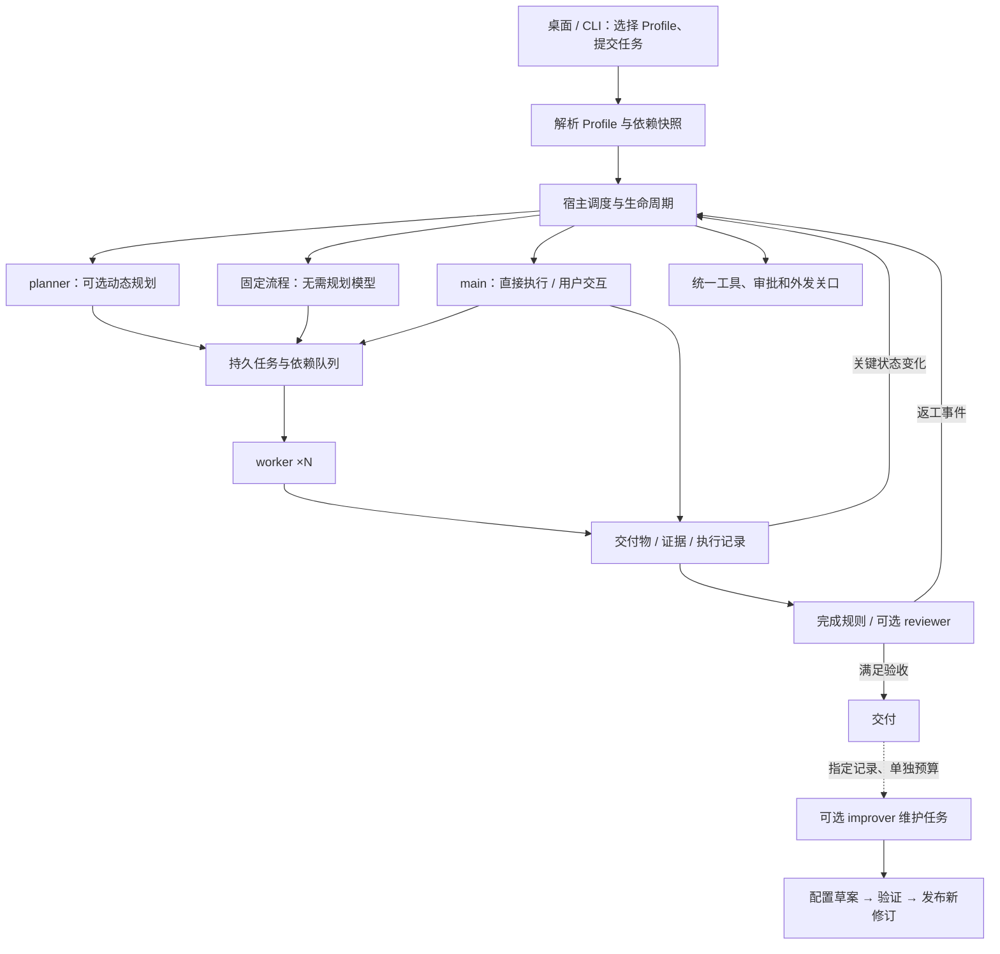

> 历史归档：不得据此决定当前删除范围。以 [P0 执行契约](../p0-refactor-contract.md)及[逐项清单](../p0-api-storage-inventory.md)为准；内部多角色执行、调度、审查、复盘和恢复保留。

> 历史档案：2026-10-16 转型前的 ICEPick 文档。阶段状态、产品要求和版本号仅作历史证据，不作为 IceTudio 当前待办。当前以[新实施计划](../../IMPLEMENTATION_PLAN.md)和[新架构](../architecture.md)为准。

# ICEPick 设计文档

状态：2026-10-12 重新设计的目标方案，尚未全部实现。当前已推送代码基线为 `ce112ce`；实际交付次序见[实施计划](icepick-implementation-2026-10-16.md)。旧设计与验收记录保存在 [历史设计](architecture-v1.md)和[历史实施记录](implementation-v1.md)。

## 1. 产品定位与核心决定

ICEPick 是本地优先、领域无关、用户可高度自定义的 Agent harness。用户通过 Profile 定义完整使用场景：指令、模型、工具、Skills、参与执行的内置 Agent 组件、流程、上下文策略及改进偏好。宿主负责把配置变成可恢复、可检查的执行。

**Profile 是唯一需要用户创建、编辑、复制、分享和管理的场景配置对象。内置 Agent 是可选执行组件，运行实例由宿主自动创建。** 用户仍可管理会话、任务和数据，但不再需要先创建一个持久 Agent、给它绑定 Profile，再配置另一套 Agent 列表才能工作。

桌面与 CLI 共用宿主、应用服务和授权机制。继续使用现有 Go/Wails/React、SQLite、模型适配器、MCP 与 Agent Skills；可选 A2A 处理远端系统互联。暂不建设通用插件加载器、插件市场、任意代码工作流脚本引擎或图数据库。

### 1.1 用户的基本使用路径

1. 首次启动选择已安装模型，使用“日常助手”开始对话；缺少模型时提供连接入口，不预装或擅自下载模型。
2. 从经过验收的内置 Profile 开始，也可复制、导入或从空白创建自己的 Profile。
3. 简单设置只显示指令、模型、工具/Skills 和工作方式；展开高级设置后编辑组件、流程、预算、记忆及配置改进。
4. 在对话中查看计划、任务树、交付物、审查意见、审批和运行状态；可补充要求、停止、继续或切换后续使用的 Profile。
5. 在 Profile 编辑器中直接要求“帮我创建适合这个场景的配置”或“根据这些任务改进配置”；查看差异、验证结果并按所选自动化程度采用。

“Profile 唯一入口”不意味着所有应用连接和私人数据都塞入 Profile。模型凭据、MCP 安装与本机权限仍有各自设置；它们从相关界面就近访问，内部数据对象不变成另一套必须手动维护的 Agent。

### 1.2 不变量

1. Profile 可自定义、可复制、可分享；组件实现和系统出厂配置随程序交付，不能被删除用户 Profile 的动作破坏。
2. 组件之间的必需交接、状态转换、权限和预算由宿主执行；提示词只指导模型行为。
3. 主任务启动时固定 Profile 及所引用执行配置的修订、组件实现版本和已选 Skill 内容版本/指纹。后续编辑只影响新任务；在途任务不混用新旧配置。
4. Profile 复用不授予会话、记忆或本机权限的访问权。运行、资料和授权有独立的本机归属。
5. 每次工具执行、模型发送、过程检索及远端通信均经过同一权限和数据检查。子任务、审查及配置改进都不能绕过。
6. 一个数据目录只有一个运行宿主；任务状态事务提交后才发通知。持久事实与实时流分开处理。
7. 副作用结果未知时停止相关执行与自动重试；新建任务 ID 或重新规划不能绕过这一限制。
8. 简单任务可以只使用直接执行；多 Agent、规划、审查、改进和远端互联均按需启用。
9. 已验证的配置需要标明模型、工具依赖与测试范围。更换依赖后，不把原验证结果当成新组合的保证。

## 2. 三种不同的对象

| 对象 | 含义 | 用户如何接触 |
|---|---|---|
| 内置 Agent 组件 | 随程序交付的执行职责、输入/输出契约、默认指令和工具约束 | 在 Profile 中启用并定制，无需创建或删除 |
| Profile | 一套可复用、带修订的场景定义 | 创建、编辑、复制、导入、分享、恢复、删除 |
| 运行实例 | 某组件在某项任务中的一次执行，具有独立上下文、状态和记录 | 查看进度、检查记录、审批、取消；由系统创建 |

“内置 Agent 不能删除”指组件定义，绝不表示整个应用只有一个全局主 Agent 或共享的 worker 会话。多个主任务可以各自创建 main、planner、worker 和 reviewer 实例，彼此隔离。

组件共用一个基础模型/工具循环。调度、任务分派、依赖验证、事件合并和终态判定是确定性的宿主逻辑，不为每项管理动作增加一次模型调用。

## 3. 五种内置 Agent 组件

| 组件 | 职责与输入 | 输出与边界 |
|---|---|---|
| `main` 主执行 | 接收用户要求、处理澄清和人在环路；直接执行或把目标交给所选流程 | 直接结果或任务交付；规划模式中不另生成与 planner 竞争的计划 |
| `planner` 规划 | 提取目标、范围、约束和验收条件；根据执行状态拆分、安排和调整任务 | 结构化计划变更、待澄清事项或完成候选；只能提出调度建议，由宿主校验提交 |
| `worker` 执行 | 接收明确任务、输入材料引用和验收条件，在获准范围内选择局部步骤和工具 | 交付物、证据、结果或阻塞；不能自行改变主目标，默认不能再委派 |
| `reviewer` 结果审查 | 根据原始要求、已确认条件、交付物和必要证据独立检查 | `passed`、`changes_requested` 或 `inconclusive`，附具体依据；默认只读，不自己修改交付物或代替用户审批 |
| `improver` 配置改进 | 根据用户需求、指定任务记录、反馈和评估结果创建或改进 Profile/Skills | 可版本化的变更提案、测试结果、影响说明；通过专用配置服务发布，不直接改授权或程序实现 |

目标提取先作为 planner 的一个阶段，不独立设置必须调用的 `goals` Agent。规划关闭时，main 仍可以理解需求和请求澄清。固定业务流程由已配置的流程产生任务，无需 planner。只有动态规划模式中 planner 是全局计划的唯一模型写入者；用户仍可修改目标，宿主仍是状态与调度的所有者。

main 是面向用户的入口职责，不要求每个后台阶段前后都调用 main 模型。直接执行可一次循环完成，固定流程也可把最终交付物直接呈现给用户。worker 的观察和局部操作不需要逐步请 planner 批准。

组件的默认行为保存在程序内，不引用一个必须存在的用户 Profile。用户可以改变组件指令、模型和允许能力；角色契约与宿主权限规则继续有效。模型生成内容必须符合组件输出 schema，无法解析时按有限修复预算处理，不能当作已完成。

## 4. Profile：完整的场景定义

### 4.1 配置内容

| 配置组 | 可自定义内容 |
|---|---|
| 基本信息 | 名称、描述、适用场景、人格和任务指令 |
| 模型 | 默认模型与各组件的可选模型绑定、必要能力要求；密钥通过本机连接解析 |
| 能力 | MCP 服务/工具、Skills、各组件可使用的能力子集 |
| 组件 | 启用的组件、组件指令、输入输出要求、worker 配置槽位 |
| 工作流程 | 直接、动态规划、固定流程；阶段、依赖、条件分支、并行汇合、审查和有界返工 |
| 运行预算 | 根任务与子任务的时间、模型轮数、并发、委派深度、输出/上下文上限及可用的用量限制 |
| 数据使用偏好 | 当前会话上下文、压缩、记忆读写偏好、任务内过程共享；实际数据访问仍需本机授权 |
| 配置改进 | 是否启用、触发方式、希望优化的指标、目标资源和自动化偏好 |
| 验证与依赖 | 输入/输出要求、验收案例、依赖引用、兼容及评估记录 |

复用现有独立配置行，新增组件、流程和改进等配置组；组合更新事务发布一致修订，运行使用解析快照。组件字段采用单层规则：未指定时使用 Profile 公共值，指定时显式替换；不引入 Profile 继承链或多层隐式合并。

公共能力选择是此 Profile 的候选上限，组件能力只能进一步收窄。高级设置可让不同 worker 槽位具有不同指令和模型。需要复用另一 Profile 时，可以显式选择它作为 worker 配置来源；读取目标的 worker 设置（未填写则使用其公共设置），不自动启动目标的 main、planner、审查或改进流程，不带入目标会话、记忆或授权。配置来源在根任务启动时解析并冻结；不支持递归配置继承。

完整嵌套工作流作为后续扩展，首版不把“复用 worker 配置”解释成任意递归运行 Profile。动态新增任务只能使用根快照中登记的 worker 槽位；增加新槽位需建立新的执行修订并明确调整范围。

### 4.2 工作流程的可组合范围

场景预设提供可编辑的起点，直接执行、动态规划和固定流程是其内部工作方式。高级编辑器允许用已有组件配置：顺序阶段、显式依赖、条件分支、并行后全部或按指定条件汇合、用户输入/审批等待，以及有次数和时间上限的返工。条件读取经过校验的结构化输出；未命中分支有明确兜底，不能无限等待。

静态流程先采用无环依赖；有界返工通过宿主明确的重执行轮次表示，不允许任意循环边。保存和运行前检查组件引用、依赖环、输入输出兼容、可达终点、必需审查、缺失资源及预算。条件由宿主求值，不执行 Profile 内任意脚本。

可以只输出计划、只做审查，或配置“检索 → 并行分析 → 汇总”。“仅规划”“只读”等限制需要能力筛选和网关执行，不能仅写进提示词。对于依赖额外工具的场景，明确显示缺少的依赖。

### 4.3 按使用场景组织的出厂 Profile 与空白入口

出厂 Profile 回答“我要做什么”，组件和流程回答“系统怎样完成”。不把“并行协作”“审查交付”等执行机制列为默认场景，用户不需要为了规划、审查或复盘切换 Profile。初步选择四个覆盖较广的场景，分别验收、按实际能力交付：

| 出厂 Profile | 使用场景与交付要求 | 初始工作方式 |
|---|---|---|
| 日常助手 | 问答、解释、简单整理与轻量工具任务；给出直接、适量的回答 | main 直接执行，独立规划/worker 默认关闭，审查按需 |
| 研究分析 | 阅读资料、多来源比较、专题研究；结论有出处，区分事实/推测，列出缺口 | planner 按依赖安排 worker，汇总后 required reviewer；用户材料可直接输入，在线检索需要已配置工具 |
| 写作编辑 | 起草、改写、润色和长文组织；遵守受众、语气、结构与内容要求 | main 直接起草/编辑，审查按需；长文可由用户开启规划和分工 |
| 开发协作 | 理解代码、诊断问题、实现与测试；交付变更说明、检查结果和未解决问题 | 规划与 worker 用于实施任务，required reviewer 检查交付；实际修改/执行依赖获准工具 |
| 空白入口 | 用户定义自己的场景、输出与能力 | 不预填人格和能力，使用最小直接流程，模型未配置时明确提示 |

每个场景预设包含相应指令、工具/Skill 依赖选择、输出要求、组件配置和真实任务验收案例，不能只改名称或仅开一个组件。它们是普通 Profile 的出厂配置，用户可修改为其他工作方式，程序不根据预设名称写死行为。

以上是目标出厂值，必须完成真实验收才作为稳定预设发布；现有代码已提供四个模板副本，其中研究/开发为试验配置，尚未达到上述稳定场景验收。协作初始并发上限 2，worker 不再委派；启用自动返工时初始上限 2，仍未通过则呈现缺陷而不标记成功。所有新预设的自动改进默认关闭；用户随时可手动调用配置改进。预设不自带模型密钥或自动下载依赖，不自动授权资源。缺少在线检索或代码执行等必要工具时，明确显示未就绪/能力限制，不把纯文字建议声称为已完成实际操作。

出厂内容是带版本的受保护模板；首次使用创建可编辑的本地 Profile，编辑不产生隐式继承。用户可重命名、修改、删除本地副本，随时重新从出厂版本创建，也可按配置组恢复。程序升级不覆盖用户改动，提供差异与可选择的更新。

### 4.4 修订、删除与分享

- 编辑、手动恢复和改进发布都创建修订；运行记录始终保留实际使用的配置。技能内容也须固定版本/内容副本，避免运行途中读取到刚被改写的 Skill。
- 删除 Profile 不删除会话、记忆、任务或系统组件；已有任务继续使用快照。历史会话保留归档名称和修订，下一次执行可选其他 Profile。
- 删除前展示引用关系：对其他 Profile 的自定义引用，要求在同一操作中选择替代来源或恢复该组件的内置默认；不静默替换。用户仍能取消删除或保留为归档配置。
- 用户 Profile 全部删除后，首页保留出厂模板和空白创建入口；系统角色不因此消失。
- 分享包包含场景配置、独立指令、标准 Skills 和依赖引用；显式选择包含 worker 来源后，将其 worker 投影展平为独立配置，不递归携带完整 Profile 或本机 ID。导入预览这些配置及其资源依赖，不自动绑定接收方本机 Profile。
- 包不含会话、记忆、运行记录、审批、凭据、本机路径绑定或授权。导入不自动安装/执行依赖，不开启定时任务、入站服务或自动改进授权。缺失配置来源不能静默当作已可用。

### 4.5 一个完整的用户配置示例

用户复制“研究分析”，创建“技术资料整理”：选择本机已接入的检索工具，配置 planner、两个 worker 槽位和 required reviewer。一个 worker 提取事实与出处，另一个检查不同材料之间的差异；planner 等材料齐备后再安排汇总。reviewer 按“结论有出处、区分事实与推测、列出资料缺口”验收，最多返工一轮。用户可以给这些组件选择不同模型，也可以全部使用同一模型。

用户在该 Profile 中把改进模式设为“验证后确认”，授权使用选定的已结束任务作评估。improver 可以建议修改检索 Skill 或 worker 指令，但只先产生草案；用户看到变更内容及候选的验收结果后采用，不运行旧配置作对照。下一次任务使用新修订，正在进行的资料整理使用原修订。

整个过程只需要创建一个 Profile、配置其组件并启动对话，不需要创建名为“规划者”“研究员”“审查员”的持久 Agent。工具连接、可用模型和真实验证仍是该配置的必要依赖。

## 5. 运行内核与事件闭环

### 5.1 任务、运行和交付物

根任务保存用户目标、范围、验收条件、所选流程快照、预算和当前计划修订。执行任务项保存稳定 ID、父任务、依赖、组件/worker 槽位、输入引用、预期输出、状态和尝试记录。Run 是某任务项的一次具体执行，沿用现有 Step/ToolCall 与结构化历史。

任务项可处于 `pending / ready / running / waiting_input / waiting_approval / blocked / completed / failed / cancelled / interrupted`；尚未满足依赖不进入 ready。根任务另外表达 awaiting_review，避免把 worker 完成直接等同于用户任务完成。ToolCall 的 `execution_unknown` 是必须处置的事实，不因为任务被取消或新开一次尝试就消失。

交付物记录内容或受控引用、版本/指纹、生成任务与 Run、数据来源及验证状态。代码、文本报告、结构化数据和文件都可表达；不要求所有场景写成领域 fact/asset/finding，也不引入渗透测试双图。观察与已验证结论分别标记，测试通过也只证明对应检查范围。

### 5.2 动态规划

1. main 接收任务，必要时向用户澄清；planner 读取目标、范围、已有交付物、计划和执行摘要。
2. planner 提出 0..N 个任务及依赖、输入和验收条件；宿主校验并用修订比较原子提交。
3. 宿主把依赖与输入已满足的任务置为 ready，worker 在并发和总预算内原子领取任务。
4. worker 独立执行并提交交付物、证据、阻塞或错误；关键状态持久化后通知协调层。
5. planner 根据新增事实调整后续计划；已完成和正在运行的任务不能被整份计划覆盖抹掉。改变在途工作的范围需明确取消/替代操作，已发生的副作用仍保留。
6. 进入完成检查，按 Profile 执行审查、返工或交付。

动态规划按根任务串行提交：一个有效规划轮次处理到指定事件序号。重复通知合并，执行期间新事件记为待处理，结束后补一轮；不能因 debounce 丢失最终变化。纯 token 流、每条工具日志、planner 自己的无实质更新不触发新规划。事件订阅用于唤醒，重启后从持久任务状态和游标补齐，不依赖内存通知存活。

持久计划保存依赖、验收、结果引用和变更原因。可以在新的模型上下文中恢复，也可保留有界规划上下文；“每轮必须全新会话”不作为架构限制。用户目标改变后保存目标修订，并标记需要重新验收的任务。

planner 派 0 个任务时：有活跃工作则等待；缺输入/权限则等待用户；无可行方向则 blocked；只有必需交付物与验收满足时才可完成。无新方向不等于成功。

### 5.3 并行、预算和恢复

- 领取任务使用事务与唯一活跃尝试约束，同一任务不被两个 worker 同时执行。计划更新使用修订校验；去重按同一计划动作/任务身份，不能仅靠任务文本去重。
- 并发适用于互不冲突的任务；涉及同一可写资源时按声明锁定或串行，资源未知的副作用默认保守串行。批量任务共享写目标时可要求隔离工作目录，汇总前再显式整合。
- 根任务预算覆盖所有组件、子任务、重规划及返工，子任务额度是它的子额度，不能通过不断新建 worker 重置总量。模型未报告用量时标记未知，至少以调用数、时间、并发和输出限额约束，不显示虚假的精确费用保证。
- 取消根任务停止新调度并通知所有子运行；已执行的外部副作用不自动回滚，结果未知继续保留待处置。
- 恢复只重建可确定的状态；执行中的副作用调用没有权威结果时进入未知处置。纯计算或已确认无副作用的工作才可按策略重试；换 worker、换任务 ID 或重规划都不能逃避未知结果阻塞。
- 整个暂停或等待审批期间是否计入墙钟预算必须明确。首版沿用可见的任务截止时间；持续任务另有运行窗口，不把普通任务无限延长。

## 6. 独立审查与完成条件

Profile 选择 `off`、`on_demand` 或 `required`，并设置检查条件与返工次数。required 是调度门槛，main/worker 不能通过提示词或工具直接绕过；用户若改变该要求，记录显式的目标/流程修订，不能伪装成审查通过。

这些是当前 Profile 的内部审查设置，不是需要切换的独立“审查交付”Profile。on_demand 由用户请求或所配置流程的明确规则触发，是否触发记录在任务中；required 则在交付前必须执行。用户也可在当前对话选择“检查这个结果”或“复盘这次任务”，创建关联指定成果/记录的单次复核任务，无需更换场景 Profile。单次复核保留独立配置快照与结论，不改写已结束任务的历史状态，也不修改当前 Profile 的长期设置。

结果检查关注交付物是否满足要求；任务复盘可以结合过程找出遗漏与失败原因。若进一步要求据此改进 Profile 或 Skill，再调用 improver 产生候选；一次复盘不自动授权修改配置。高级用户仍可主动创建专用审查 Profile，但不把它作为普通场景使用审查能力的前提。

reviewer 默认使用独立上下文，只接收用户要求、已确认验收条件、实际交付物以及获准的证据；可检索相关工具记录，不只阅读执行者自己的完成总结。独立模型是可选设置，不保证因此一定正确。

编译、测试、格式、数据校验等确定性检查由工具执行；reviewer 分析证据覆盖和缺口。检查工具也走网关，有副作用的测试需获准执行，不能因名为“审查”就自动获准。无法运行必要检查时返回 inconclusive，不能声称已验证。

审查结论绑定目标修订、交付物版本/指纹和检查条件；交付物或目标发生变化后，旧通过结论失效。提交交付前由宿主复核这一绑定。

- `passed`：所有必需检查满足，宿主可以进入交付。
- `changes_requested`：列出具体缺陷和证据，交回 planner 或固定返工步骤；直接模式由 main 修正。
- `inconclusive`：缺少材料、工具或必要判断依据，等待补充或明确结束为未通过验收。

达到返工/时间预算后停止，返回现有交付物与未解决项。未通过验收可以向用户展示阶段性结果，但根任务不得标记已验收成功。reviewer 不代替用户授权，也不保证开放式任务在数学意义上被“证明”。

## 7. 数据归属、上下文与过程共享

### 7.1 自动管理的本机使用上下文

内部使用 `context_id` 关联会话、记忆与本机策略，它承载对话的数据归属和授权，不需要用户管理。首次独立对话自动创建；继续对话沿用。新对话默认隔离，可通过“沿用此对话的记忆与权限”显式选择既有上下文；长期记忆因此能跨会话复用，而不因同一个 Profile 自动共享。

会话可以切换后续使用的 Profile，但 context_id 不变。已有历史来源与权限继续生效；启动新的独立对话才得到新的默认隔离上下文。引用同一 Profile 不会合并不同上下文。

Profile 页展示记忆与工具的使用偏好；对话中的“本机权限/记忆”管理当前上下文。没有当前上下文时，Profile 编辑器只编辑偏好与所需资源，不静默给所有使用者授权。模型连接和资源路径通过本机映射保存，分享配置不能绑定他人的目录或凭据。

可选长期记忆需要 Profile 偏好和上下文本机授权共同允许；默认 worker/reviewer 不访问长期记忆，只用明确材料。高级用户可指定允许的记忆库与读写方式，由上下文授权再次约束；这不是访问配置来源 Profile 的其他会话。improver 只读用户指定或授权范围内的记录。

### 7.2 任务内过程共享

提供受控的搜索、列出和按步骤取回能力，等效于 `search_task_traces`、`list_task_traces`、`get_task_trace`。默认仅在同一根任务内、组件获准的数据范围中使用；返回来源任务/Run/Step、观察或验证状态、截断情况及敏感度。先搜索摘要，再取必要的完整步骤，避免整批复制全部 worker 历史。

共享的是工具输入输出、显式观察、错误、交付物和检查记录；不依赖也不要求模型提供私有推理链。任务范围过滤、字段过滤、大小预算和来源限制在检索服务落实。排除自己可减少重复，但不是权限边界。

新观察不自动成为确定事实；planner/worker 可引用它并安排验证。关闭过程共享不影响显式交付物传递。跨根任务的记录检索需单独选择与授权，不能由复用 Profile 推导得到。

### 7.3 历史与压缩

保留有序用户/助手消息、完整工具调用与匹配结果。压缩只改变模型上下文投影，不删除原始记录；按完整闭合轮次处理，保留当前任务和未完成调用。摘要继承来源限制，压缩失败时不静默丢弃任务信息。普通对话、worker、planner、reviewer 都有各自上下文预算，共享长期记忆不是压缩的前提。

## 8. 配置改进：Profile 与 Skills 的版本化改进

improver 是可单独调用的维护组件，不是每次任务的隐藏尾步骤。它既能从自然语言需求创建新 Profile，也能调整既有 Profile 的指令、模型绑定、能力选择、组件和流程，或修改相关 Skill 内容。触发方式为用户主动请求、用户反馈、任务结束后按已配置规则触发；定时/外部事件触发随对应宿主能力交付。

### 8.1 改进生命周期

`明确目标与目标版本 → 读取获准证据 → 生成候选差异 → 静态检查 → 案例验证与比较 → 采用/拒绝 → 观察与回退`

1. 提案保存用户目标、输入证据、基础修订、涉及资源、修改原因、影响范围与预期指标。一次反馈可产生建议，不能据此宣称普遍改善。
2. 候选写入独立草案/暂存 Skill 版本，不改当前生效配置。多个 Profile 共享 Skill 时显示全部受影响者；默认先生成候选副本或版本引用，不直接覆盖共享文件。
3. 验证包含配置 schema、流程、依赖、授权影响与任务案例。模型协议假测试不能替代真实效果验证；使用用户指定或预设案例检查候选的完成度、必需检查、时间与模型调用/用量，不运行旧配置或维护新旧配置对照机制。
4. 评估有独立预算与隔离数据；有副作用的工具默认替换为可验证的模拟或受控环境，只有用户明确授权才执行真实副作用。不能为“优化”重复提交、发消息或修改实际资源。
5. 发布时复核资源基础修订及授权，原子提交所需 Profile/Skill 引用组合。人工编辑已抢先发生则提案过期，需重新生成或合并，不能覆盖。磁盘 Skill 内容先写入不可变版本，再在事务内切换引用，避免半套配置生效。
6. 记录结果和不确定性；没有足够验证时只标记未验证建议。回退是发布一个恢复旧内容的新修订，不改写历史运行。

### 8.2 自动化程度

| 模式 | 行为 |
|---|---|
| 关闭 | 无自动维护调用；用户仍能手动创建/编辑配置 |
| 建议 | 生成草案和差异，用户决定是否验证与采用 |
| 验证后确认 | 在已授权评估范围内测试，用户查看结果后采用 |
| 限定自动采用 | 在用户明确授权的资源、字段、预算和门槛内，通过验证才自动发布；不符合条件则保留草案 |

Profile 保存改进偏好和建议范围；实际读哪些记录、改哪些 Profile/Skill、能否自动发布，由本机维护授权单独限定。导入包中的自动采用声明不会激活授权。默认新配置不开启自动采用。

improver 可以提议修改用于自身的 Profile，但不能在同一改进任务里改写自己的生效快照、维护权限、验收规则或预算来让提案通过。评估标准来自用户/受保护案例，其变更与候选分开审查。配置发布不自动再次触发自身优化，设置去重、冷却与轮次上限；运行内核和组件实现不在自修改范围内。

## 9. 权限、模型与标准能力

### 9.1 单一执行关口

有效调用范围取当前使用上下文授权、根任务起始范围、组件能力约束和目标资源实时限制的交集。子任务必须继承整条祖先链的范围、预算与实时撤权，不能只检查直接父任务。复用另一 Profile 只取得配置，不带来它的授权；若本机对目标配置另有更严限制，同样取交集。

三种审批模式保留：全人工、半自动、全自动。模式仅决定已获准调用如何确认；默认半自动自动执行纯操作和已授权普通读取。当前外部 MCP 按 external/unknown 处理，各模式仍需确认；精细登记需后续实际工具支持。父任务对一次调用的批准不能复用到子任务的新调用。

Profile 的能力选择不等于授权。工作区边界、命令/网络目标、风险分类和最终 guard 由宿主执行；参数及目标变化需重新审批。调用前先持久化 executing，写入失败不分派。未知结果处置保留依据与核对结果，不能通过 planner 再派任务来盲目重放。

工具调用顺序固定为：参数/能力校验 → 策略判定 → 所需审批 → 实时权限最终复核 → 持久化执行态 → 实际分派 → 结果提交。后续组件不能推翻前序拒绝；Profile、Skill 和模型指令都不能改变这个顺序。

权限收紧立即影响在途组件，放宽需要显式扩大任务授权范围或启动新任务。新建上下文默认半自动、无额外资源及远端外发授权。

### 9.2 模型与外发

沿用当前本地 Ollama/LM Studio 兼容接口以及 OpenAI Chat Completions、Anthropic Messages、Gemini generateContent 的官方 SDK 适配。其他协议/能力明确按实际支持声明。统一消息、工具调用、流式、取消、用量和错误表示；SDK 不接管工具循环。

发送前检查实际 payload、具体端点和内容累计来源，覆盖提示词、Skill、工具定义/参数、历史、记忆、过程记录、子任务结果和摘要。凭据独立保存，持有密钥不等于授权外发；同一限制适用于 reviewer、improver、评估调用、Jev 和 A2A。来源限制保守传递；不承诺自动识别所有秘密。

模型替换或远端回退不得静默改变数据目的地、必需能力和验收条件。Profile 可声明明确的备用选择，仍须运行前或发送前校验。没有可用授权或能力时显示阻塞，不能关闭审查来掩盖模型不支持结构化输出。

### 9.3 MCP、Skills 与可选互联

MCP 继续承担工具协议。服务在实际需要时按需启动，配置明确 cwd、环境允许列表、超时、进程组清理和指纹登记。外部进程自身权限不是 Go 接口能隔离的；不把审批机制表述为完整沙箱。

Skills 继续使用标准目录与 SKILL.md，发现不执行脚本、不自动安装依赖。配置改进在版本化服务内产生标准 Skill 内容，不发明另一种替代格式。MCP/Skills 目录可共享，任务状态与资料不因此共享。

Jev 只在有真实结构化判断用例时作为可选后端。A2A 以后将显式发布的 Profile 映射到独立根任务，上下文和授权由本机发布绑定指定；导入 Profile 不公开服务。两者不作为本次重构前置条件。定时/事件触发、长时间等待的持续任务属于后续宿主能力，当前不声称已支持。

## 10. 桌面、CLI 与内部数据契约

桌面主要入口是 Profile 库、对话/任务、资源连接、运行记录。Profile 编辑器提供基本设置与高级的组件/流程/改进设置；内置组件说明直接在编辑器展示，不另设必须维护的 Agent 列表。对话中显示当前运行快照和后续 Profile，审批、记忆、权限就近管理。

CLI 的目标行为是选择 Profile 创建会话、提交任务、查看计划/子任务/审查、审批或取消；不要求先执行 `agents create`。当前命令见 README。桌面/CLI 不能绕开宿主直接修改数据库。

| 内部持久对象（逻辑名称，非已交付表结构） | 作用 |
|---|---|
| profiles / profile_components / revisions | 场景定义、独立配置组、修订与出厂来源 |
| contexts / policies / grants | 自动管理的状态归属、本机资源授权和外发范围 |
| sessions / messages / summaries / memories | 会话历史、上下文投影及显式授权的跨会话记忆 |
| root_tasks / plan_revisions / task_items / dependencies | 用户目标、可恢复计划、任务队列、依赖与状态 |
| runs / steps / tool_calls / approvals | 组件执行、具体调用与结果，关联根任务和配置快照 |
| artifacts / reviews | 交付物版本、证据、验收结论与绑定 |
| change_proposals / evaluations / resource_versions | Profile/Skill 候选、验证、发布与回退 |

优先扩展现有表和契约，直接创建当前数据结构，不一次性建全套空表。组件定义初期是静态注册，不需要数据库里的可编辑程序实现。执行事件与未完成流式文本沿用现有模式：状态及时持久化，token 增量广播与内存合并，最终消息完整提交。

## 11. 开发阶段的格式与接口政策

项目尚无实际用户，优先保证当前设计简洁。没有明确要求时不维护旧数据库迁移、旧分享包读取、旧命令适配器或旧运行解释器，也不为这些分支保留测试。数据库和分享包只接受当前格式；不支持的版本明确报错，不自动转换或删除原文件。

当前数据库格式 v24，直接创建 Profile 配置、对话、本机上下文、运行、工具记录、动态任务与审查所需结构；分享格式 v6。Profile 修订、当前格式重启恢复、事务一致性和资源权限仍是运行功能，继续验证。维护者明确告知项目已有实际用户后，再根据真实升级需求制定兼容策略。

## 12. 实现记录与当前差距

本节按增量保留历史；早期“尚未实现”描述当时状态，旧兼容路径已经按开发阶段政策删除。当前已交付 R3 动态协作及 R4 审查门槛；最新待实现清单与优先级见[实施计划](icepick-implementation-2026-10-16.md)。

2026-10-12 第一增量已实现：v12 以 contexts 视图承接旧身份，新增对话级 Profile 选择、执行配置组、修订及归档；direct 流程的 main/worker 已接入共享循环，运行保存组件与版本。桌面和 CLI 已支持选择 Profile 自动创建上下文，程序提供日常助手、写作编辑模板副本与按配置组恢复，分享包 v3 保存组件设置并读取 v1/v2，可经显式选择将引用来源展平为独立 worker 配置。第二增量 v13 已接入 worker 槽位、来源 Profile 投影、根任务依赖快照（修订、模型、选中 SKILL.md 内容及指纹）和引用替代归档。已有旧委派仍使用原身份和双边授权，冻结起始配置并复核祖先实时限制。模板通过模拟验证，尚未通过真实模型验收。

已有代码：模型/工具循环、流式、权限与外发网关、结果未知处置、SQLite/单宿主、桌面/CLI/IPC、MCP/Skills、上下文压缩、逐旧 Agent 记忆、计划记录、同步本机委派和 Profile 分享。上一轮检查通过 Go 全量测试、前端与 Linux 构建；真实模型与桌面验收仍未完成。

尚未实现：完整流程契约与旧委派目标转换的用户入口、planner/reviewer/improver 执行契约、研究分析/开发协作预设、可调度依赖计划、同根任务并行 worker、关键事件规划、固定流程编辑与执行、独立审查门槛、受控跨 worker 过程检索、Profile/Skill 改进和评估发布。

现有 Plan 是有序待办记录，不是依赖调度器；现有委派在父工具调用内同步等待，配置了并发上限不代表已经实现并行执行。当前外部 MCP 可经审批调用，但内置通用写文件、命令和网络工具尚未提供；开发、自动化等场景需要适用 MCP 或另行实现工具。现有模型适配不应被描述为已经支持未实现的多模态、定时或长期持续运行能力。

新核心版先交付 Profile 入口、main/worker 装配和日常助手；协作、审查、固定流程和配置改进分别按验收结果交付。未实现的组件与预设显示为不可用或不展示，不用空开关冒充功能。

2026-10-13 R3 首个增量（数据库 v14）：会话 Plan 增加稳定 ID、依赖、验收条件、输入出处和修订历史。模型经 `local__update_plan(expected_revision, steps)` 提交；宿主拒绝无效依赖、过期修订及已开始任务契约改写。清除计划保留递增修订，旧响应不能复活已清除计划。旧待办自动补 ID，历史状态和备注保持。此处仍是模型维护的会话记录，不是原子领取或实际执行状态；独立根任务、尝试、planner 和并行调度尚未交付。

2026-10-13 R3 第二增量（数据库 v15）：根 Run 关联 task_roots，保存目标及单调修订；task_items 保存执行条件和宿主状态，task_attempts 原子关联任务项与子 Run，task_plan_revisions 保留声明历史。现有会话 Plan 不被自动转成调度任务。main 经 local__task_plan 提交声明，经 local__delegate_task(taskId, taskFingerprint) 按实际依赖领取；条件指纹约束审批，领取/子 Run/尝试一起提交。前置交付物从成功 Run 的原消息读取，带任务与 Run 出处；权限和外发沿用祖先检查。Run 终态和工具未知处置驱动任务状态，未成功计划阻止根任务完成；succeeded 不代表独立验收通过。进程恢复仅收敛记录，绝不盲目重放。桌面/CLI 提供状态与尝试查看。独立 planner、自动恢复、重试、并行、资源冲突与全组件预算仍待实现。

2026-10-13 R3 长任务交付（v16）：dynamic 流程接入 planner 独立规划会话及 Run（逻辑组件保存在 run_components，旧 runs 物理字段保持兼容）。task_coordination / task_events 保存语义事件、游标与明确状态；root_budgets / model_usage 为全部组件和摘要请求保存共享预算与未知用量。已知只读任务并行，write/unknown 全局串行；read 声明由网关强制，外部 MCP 不属于可信只读工具。重试默认关闭，只能有界替代无副作用失败任务，旧尝试不抹除。task_artifacts 指向原交付消息、SHA256 和实际工具证据，状态 unreviewed；worker_observations 与原 tool_calls 支持同根、排除自身的受控过程交换，结果继承数据范围。权限及所有允许身份的外发授权冻结起始上限，执行/发送前仍复核实时限制。恢复原子收敛未知结果、用量和事件，阻塞等待显式继续，不后台自动续跑。模型适配器提交 8192 输出上限，未知 token 使用请求字节量加输出上限的保守预留；它不是已测量的实际用量。分享 v4 保留新配置并读取旧包；研究和开发仅为试验模板，reviewer/固定流程/improver 继续待实现。

2026-10-13 R4 首批交付（v17）：reviewer 已开放为独立、无工具的审查组件，使用冻结模型配置、独立上下文与同根预算。Profile 配置 off/on_demand/required；required 既在执行流程又在存储完成事务强制检查。task_reviews 保存目标/任务契约/最终消息/交付物/实际工具记录的绑定指纹与 passed/changes_requested/inconclusive；变化后旧结论不可用于完成。必要检查工具的最后结果必须成功且返回 JSON `{"passed":true}`，否则宿主不能承认 passed。review_requests 支持当前 Profile 对历史结果作单次审查，使用新根预算，不改旧终态或配置。分享 v5 保留 reviewer 与条件并兼容旧包；日常/写作模板 v2 默认按需，研究/开发试验模板默认 required。当前 reviewer 不执行工具，自动返工、专用确定性检查调度与复盘专用契约继续待实现；未作真实模型验收。

2026-10-13 范围收敛：内置操作工具采用最小基础集合——读取、写入、精确编辑文件及命令执行；现有 read_file 可复用，其余三类尚待实现。网络请求、检索、目录浏览、编译和测试使用命令或外部 MCP；Skills 组织场景方法。已实现的规划、委派、记录工具继续按组件需要提供。持续/定时任务与嵌套工作流移出当前主线，不继续扩展调度机制。基础工具仍复用权限、审批、预算、取消与留痕；命令执行不等于文件/网络沙箱。

2026-10-13 工具发现与执行范围：服务商云端代码执行不纳入当前实现，脚本和项目走本地命令或实际配置的本地沙箱。当前已有 MCP 按运行选择连接及工具枚举，但模型仍接收过滤后的完整定义，没有工具搜索/按需 schema 加载。计划内置跨提供方的 tool_search，仅搜索当前 Profile/组件可用目录并按运行加载真实定义；发现不等于授权，实际调用保留原审批、外发、预算和指纹校验。

2026-10-13 基础工具与发现交付：read_file 继续可用，新增 write_file/edit_file/exec 与跨提供方 tool_search。文件修改核对原内容并在授权目录内提交；命令具有工作目录、退出码、输出上限、超时取消及审批，未提供完整操作系统沙箱。真实 MCP 定义在搜索后下一轮加载，Engine 动态刷新实际可调用集合；加载记录使用原 ToolCall/Step，调用前拒绝变更 schema。支持 main 和 worker 各自的发现状态，不扩大 read worker、planner 或 reviewer 能力。所有验证使用模拟模型、本机模拟 MCP 和本地测试进程；联网搜索仍待实现。

2026-10-13 开发阶段简化：当前数据库 v18 直接保存 Profile 完整配置与运行组件，分享包仅接受 v6；不再迁移旧数据、读取旧分享格式或通过旧 Agent 管理入口启动任务。委派统一使用配置槽位与当前对话授权。基础 read/write/edit/exec 及 tool_search 已实现；外部工具统一先发现、下一轮调用。删除迁移和旧接口测试，继续验证当前持久化、权限、审批、取消、预算、冻结配置与事务一致性。旧委派目标转换不再列入待开发项。

2026-10-14 联网搜索首批：对话选项在根任务事务内冻结，OpenAI 使用 Responses web_search，搜索 MCP 需通过配置 webSearchTools 显式登记并由组件选择。原生查询每请求最多 3 次，预留和已知退款使用共享根工具预算；事件与结果绑定模型 Step，失败/重启保存 execution_unknown 且不重放。网页材料按 unknown 范围约束外发；MCP 沿用既有审批和指纹校验。planner/reviewer/摘要器继续使用已有证据。数据库直接创建 v19，不迁移 v18；分享仍为 v6。Anthropic/Gemini 原生协议及真实服务验收仍待实现。

2026-10-14 Anthropic/Gemini 适配：Anthropic 使用 web_search_20260318/direct 和 max_uses，避免云端代码过滤；Gemini 3/4 文本模型使用新版官方 SDK 的 Interactions，搜索与函数工具共存，关闭搜索后继续回放完整步骤/签名。统一 provider_state 保存服务商协议状态，数据库直接初始化 v20，无旧字段/格式读取。Gemini 内部搜索无法硬限次数，以宿主搜索请求为根工具预算单位，内部次数和费用未知；OpenAI/Anthropic 使用实际搜索调用数退款。Google 建议在隔离禁脚本 iframe 中显示；全部路径保留原外发/取消/组件上限，SDK 不重试失败请求。模拟协议与宿主验证已覆盖，真实验收仍待完成。

## 实现记录：v21 概念清理

- `Profile` 是场景配置，`LocalContext` 是本机状态和权限所有者，`ContextPolicy` 是实时授权，`RunProfile` 是一次运行的解析配置，main/planner/worker/reviewer 是执行组件。
- Context 不引用 Profile，也没有默认 Context。普通 Session 必须明确引用 Profile；组件 Session 记录来源 Profile，实际执行始终采用根任务冻结的组件配置。
- `sessions.context_id` 是会话归属的唯一来源；messages/runs/session_plans/session_summaries 的 Context 通过 Session 查询。运行与消息的所有者关系不可改写，有历史的 Session 不允许更换 Context，子运行必须属于父运行的 Context。
- API 从 sessionID/runID/callID 推导归属，调用者不再重复传身份参数。IPC 仍验证本机连接身份，并拒绝未知参数；工具执行继续检查该 Context 的授权和审批状态。记忆与外发授权等按 Context 管理的资源保留显式 contextId。
- 根任务冻结 `RootContextID`、`RootPolicy` 和 `Grants[destination]`。各组件只改变执行配置，不改变权限身份。执行权限取冻结上限与实时权限的交集，撤销立即约束后续执行，新增授权只用于新任务。
- 当前只接受数据库 v21；旧格式拒绝且保留原文件，不提供迁移或旧契约适配层。

2026-10-14 R4 有限返工交付：required 在审查缺陷或缺失必要检查时交回执行组件，最多两轮，共享原根预算、冻结配置及授权。direct 由 main 修正；dynamic 由 planner 安排新增修正任务，任务/交付物/工具引用定位原 worker，宿主校验修正成功后才允许汇总。必要检查通过已有工具关口补做，返工之后不能复用旧成功检查。旧交付、尝试和审查保留；未知效果、拒绝必要操作、耗尽预算或超轮次不标记成功。on_demand 保持单次只审查；复盘专用契约尚待实现。本批仅模拟模型与本机命令验证，未完成真实场景验收。

2026-10-14 R4 过程复盘交付（v22）：当前 Profile 内调用独立 reviewer，使用过程专用 JSON 契约与新根预算。复盘运行树、步骤状态、任务/交付及真实工具证据，支持没有最终交付的失败/取消/中断任务；不执行工具、自动返工或改配置。观察绑定真实记录并与全过程指纹共同保存于 task_retrospectives，单次请求保存于 retrospective_requests；材料变化后标记失效，不把复盘当作 passed 验收。桌面和 CLI 已接入，过程数据范围继承到 reviewer 与请求会话，远端发送沿用冻结/实时授权。当前只接受数据库 v22，分享格式仍为 v6；模拟、IPC、浏览器验证不替代真实场景验收。

2026-10-14 R6a Profile 草案首批（v23）：improver 是显式、无工具的单次配置生成组件，在当前 Profile 控制下提出新建或改进草案；不读取对话历史或任务过程。候选与基础修订独立持久化，用户查看差异、影响范围、说明和未验证限制后可编辑、手动采用或丢弃；发布与候选状态同事务，冲突不自动合并，撤销不覆盖后续编辑。当前不生成 Skill 候选，不执行场景评估或自动采用，不做新旧配置对照。数据库只接受 v23，分享仍为 v6。

2026-10-15 R6a Skill 与任务证据交付（v24）：improver 根据明确指定的源 Skill 和最多3个同上下文已结束任务提出候选，真实引用及过程指纹由宿主校验，证据改变后拒绝采用；预期验收条件不表示已经执行评估。Skill 采用发布数据库持久化的不可变副本，通过统一目录按需加载、冻结与标准 SKILL.md 分享，不覆盖共享源或自动切换显式引用；撤销不影响在途快照。采用后的 Profile/Skill 保留来源范围，Profile 复制/后续修订与 worker/Skill 依赖冻结也保守继承；分享前显示来源检查且不附原任务。当前只接受数据库 v24；分享仍为 v6。真实效果验证、R5 固定流程和 R6b 自动采用继续独立跟踪。

2026-10-15 R5 首批：fixed 使用 execution.stages 静态 DAG，复用 dynamic 的宿主调度器、审批、claim、依赖交付装配、权限/外发和预算。根 Run、阶段与首个计划修订在同一事务创建；模型不能修改 fixed 图、派发无绑定任务或重复领取。fixed 不依赖 PlanEnabled、不捕获 planner，协调轮次保持 0。read 并行，write/unknown 串行，全部实际成功后 main 汇总；必需 reviewer 不通过即停止，尚不支持自动返工。桌面阶段列表、分享和配置组恢复已接入。失败/拒绝/未知效果不派后继或自动重试；重启保留记录并停止，不承诺显式续跑。阶段条件、输入等待、固定返工与显式续跑仍待实现；当前数据库仍 v24、分享 v6，无迁移/旧格式读取。

2026-10-15 基础材料输入（v25）：消息附件与来源范围在同一事务保存，列表投影仅含元数据，模型适配器输出服务商原生文件块；执行、规划、审查、复盘及摘要读取持久化材料。已有联网开关声明网页读取工具并复用预算与事件存储。read_file 增加有界目录列表；Skill 依赖快照包括 references/scripts/assets，load_skill 按相对路径读取固定内容，副本/分享保留资源。桌面附件与 Profile 导入导出分开，管理区折叠。当前只接受数据库 v25，分享仍 v6。详见[材料输入](../materials.md)。
