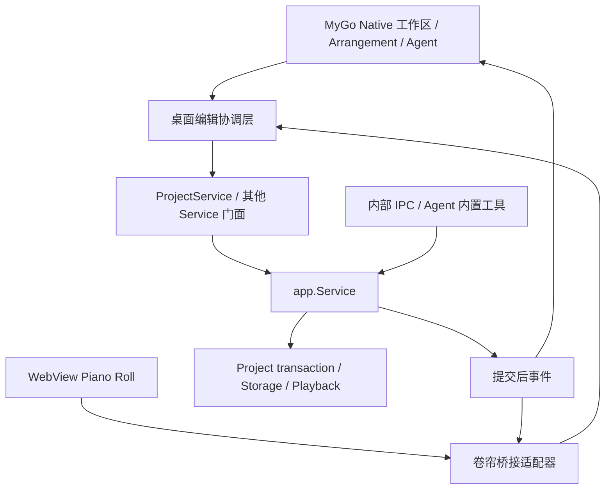

# IceTudio：Wails → MyGo Hybrid 迁移规范与实施计划

日期：2026-11-02。对象：维护者、UI 设计者、迁移实现者与验收者。

状态：2026-11-04 框架替换与代码清理已落地：正式入口采用 MyGo（2026-11-08 已升级到 v0.8.3），普通工作区、Arrangement、Agent 和设置为 Native，钢琴卷帘继续使用 WebView。维护者明确授权按 tests/retired-react/README.md 退役旧 React 载体；Wails Go/npm 依赖、绑定和专属脚手架已移除。本文仍是迁移设计与验收约束，不把代码完成视为 A1–A10 全项通过；实测范围和未验收项见[收尾记录](mygo-acceptance.md)。后续章节中的阶段动作是原实施门槛，历史事实见[执行记录](mygo-progress.md)，当前调用定位见[门面清单](mygo-inventory.md)。

## 1. 权威、优先级与范围

从本日起暂停 [DAW 扩展 E0–E8](daw-expansion/implementation.md) 的新增功能实施，优先完成本迁移。已有成果保留，扩展目标不取消。迁移期间只实现框架替换、UI 重做及其必要的等价接线；Mixer、Automation、Audio Clip、录音、插件宿主等尚未实现能力继续属于后续扩展，不能用空面板宣称交付，也不作为本次迁移完成的前提。

本文在 GUI 技术选型、Native/WebView 分工和迁移顺序上替代旧文档的 Wails/React 目标描述；旧文档中已发生的接线与验收记录保留为历史事实。根 IMPLEMENTATION_PLAN.md、[架构](architecture.md)、[P0 保留边界](p0-refactor-contract.md)及 P1–P4 的工程、授权、事务、草稿、恢复和执行内核契约继续有效。迁移不得以“重做界面”为由删掉后端执行能力或必要用户入口。

执行阅读顺序：AGENTS.md → 本文 → 当前架构和受影响 P1–P4 契约 → 实际调用者/存储/测试。代码、旧记录与本文发生矛盾时，先核实并修正文档；未解决的删除范围默认 KEEP。实现者逐阶段回写证据，不能直接改历史验收为 MyGo 已通过。

### 2026-11-03：执行顺序与 Agent 重构冻结

用户确定的顺序为：**MyGo App 迁移与 UI 重做 → 完整 DAW 编辑器功能及验收 → ADK/Agent 循环替换评估**。这里冻结的是 Agent 内核技术路线和非必要重构，不是停止 App 迁移或取消编辑器建设。

- 第一阶段按本文 M0–M6 完成迁移；第二阶段恢复既有 E0–E8 路线，以[功能矩阵](daw-expansion/feature-matrix.md)和[验收矩阵](daw-expansion/acceptance.md)为范围依据。“完整编辑器”不能缩减成当前 MIDI 界面或仅编译通过；尚未确定的服务、平台、资源授权及验收缺口仍需显式解决或由维护者调整范围，不能默认为完成。
- 在前两阶段结束前，不引入 ADK 替换当前循环，不重做任务调度、会话存储、上下文压缩、角色/委派、审批、预算或恢复体系，不并行启动 Agent 框架迁移。
- 允许迁移现有 Agent UI、适配框架通信，并为新增音乐对象接通既有查询/编辑/差异/权限路径；保持原 Service、冻结范围和共同事务。此类必要接线不构成引入 ADK 或扩大 Agent 重构范围的授权。
- 影响现有功能、安全、事务或恢复的实际缺陷可做必要修复并验证，不能以冻结为由保留已确认的阻断；修复不得附带无关框架重写。
- 两阶段达到各自验收条件并由维护者确认后，才重新评估是否采用 ADK。ADK 端点支持的讨论只是候选研究，不是已经决定依赖、替换或删除当前循环。

### 2026-11-03：Native 界面方向确认与 Wails 退役

维护者查看实际预览后确认“效果很好，可以把 Wails 扔了”。本次确认采用 Native UI 方向，并将 Wails 定为待删除的旧框架；不再为旧外壳投入视觉重做。它不是完整编辑、关闭恢复、Agent/设置迁移或跨平台验收结论。实现者继续补齐新入口并按第 4 节 REPLACE 门槛删除 Wails 的精确依赖和载体；不把只读视觉样例当作现有能力的等价替代，不永久维持两套外壳。

## 2. 确定的产品分工

“Native”指 MyGo `ui` 在原生窗口中的自绘界面，不保证每个控件都是操作系统控件。系统文件选择等采用 MyGo 的原生桌面 API。Native 不能自动证明美观、低延迟或低内存。

| 区域 | 最终归属 | 约束 |
|---|---|---|
| 主窗口、标题栏、Toolbar、Transport、状态栏、Pane/Split View | Native | 聚焦音乐工作区；窗口、输入法、缩放、焦点均需原生验证 |
| Browser、工程管理、轨道/片段属性、音色管理 | Native | 新建/重命名/导入/导出/删除确认/恢复均有可用入口 |
| Arrangement/Playlist、轨道头、Clip、编排时间尺 | Native | 正式实现不得继续调用 React Arrangement 充当主体 |
| Agent 输入、消息列表、Markdown、代码块和 GFM 表格 | 优先 Native | 使用 MyGo `ui/markdown`，先验证本项目内容与中文流式交互 |
| 审批、材料外发确认、候选差异、任务详情、Skills/MCP/搜索/设置 | Native | 具体对象、目的地、范围、恢复与操作按钮保持可见可用 |
| Dialog/Popover/表单/List/Table/Tree | Native | 禁止浏览器 prompt/confirm 或强制 JSON 编辑作为正常流程 |
| Piano Roll 内部键盘、音符网格、属性通道、内部时间尺、ghost | WebView | 保留现有 GridSound 子集及编辑交互；本次不重写卷帘引擎 |
| 卷帘外部量化/移调/力度/吸附/缩放等普通工具栏 | Native | 通过明确协议获取冻结选区并发出命令；逐项迁移后再移除旧控件 |
| 后续 Mixer、Automation、Audio Clip/Playlist | Native 目标 | 当前不新增相应音乐模型、音频引擎或编辑功能 |
| 将来确实依赖 DOM/Web Components 的创作组件 | 单独评审的 WebView | 使用 npm 不自动构成保留 WebView 的理由 |

Agent 消息正文允许有条件使用 WebView：M1/M5 的实际验收若证明 Native Markdown 在必要行为或质量上存在缺口，记录样例、固定版本、影响与选择理由后，可以仅将消息正文阅读区交给 WebView；输入、审批和任务操作继续 Native。该例外不允许把整个 Agent 面板或其他普通 DAW UI 永久搬回 React。采用例外后同步本文分工和验收记录，不同时维护两个正式正文渲染器。

2026-11-04 已采用的正文例外：普通聊天 Markdown、代码块、表格、文本附件及静态图片保持 Native。PDF/GIF 附件及供应商提供的搜索建议 HTML/CSS 使用只读正文 WebView，因为 Native Markdown 不提供 PDF/动画阅读及供应商 HTML 布局。输入、列表、审批、任务操作仍 Native。页面采用 Untrusted 禁止 Go 方法，HTML 在无脚本 sandbox iframe 内；真实窗口已验证绑定拒绝和脚本不能逃逸父页，不据此声称全部恶意导航矩阵通过。不存在整套 React Agent 面板回退。

## 3. 已核实事实与尚未验证事项

2026-11-02 核对官方文档及当前项目代码：

- MyGo 文档提供 Native 窗口内 `Window.NewWebView`/`ui.WebView`、生成客户端、typed events 和 Go services。文档还描述 Native 弹层覆盖 WebView、焦点/Tab 协作；这些是框架文档能力，不是 IceTudio 的实测结果。来源：[嵌入 WebView](https://mygo.egoist.dev/docs/ui/web-view)、[bindings](https://mygo.egoist.dev/docs/bindings)。
- `ui/markdown` 文档提供 CommonMark/GFM、表格、代码高亮和复制、文本选择、流式显示；公式默认可显示 TeX 源文，自定义图表接口不等于内置 Mermaid 渲染。当前 IceTudio 使用 react-markdown/remark-gfm，跳过 HTML，图片显示链接。迁移保留该产品边界，不自动加载远端图片或执行消息中的 HTML/JS。来源：[Markdown](https://mygo.egoist.dev/docs/ui/markdown)。
- MyGo 的 Native 绘制和事件回调在 UI 主线程；慢服务操作放后台，结果经 `Window.Update` 等机制回到视图。来源：[Views](https://mygo.egoist.dev/docs/ui/views)、[生命周期](https://mygo.egoist.dev/docs/app)。
- 候选验证版本为 MyGo `v0.7.4`，其 [go.mod](https://github.com/egoist/mygo/blob/v0.7.4/go.mod) 要求 Go 1.27.3；这是初始审查时的状态；2026-11-04 已固定采用该版本。M0 固定验证版本及文档/源码 commit，M1 通过后才确定采用版本，禁止无版本 `@latest` 进入可复现构建。
- 官方架构描述 Linux GTK3 与 WebKitGTK 4.1/4.0 路径，区别于当前 Wails 的 GTK4/WebKitGTK 6.0；固定版本须复核实际运行库和发行依赖。MyGo 不使用 cgo，不代表 IceTudio 的 SQLite/FluidSynth 可关闭 cgo。来源：[平台架构](https://mygo.egoist.dev/docs/architecture)。

本节记录初始源码/文档审查。2026-11-03 后续局部实测以执行记录为准；全面原生兼容性、GPU/CPU 成本、WebView 合成、中文输入、密集 Clip 和真实播放仍待验证。官方基准或其他机器的演示不能替代项目证据。

## 4. 操作清单与删除边界

下表是已定位的子系统清单，不声称已逐项审计全部导出方法或全部前端入口。M0 必须补齐方法级与入口级清单，记录原调用者、新调用者、测试和验收结果后，才可拆除旧载体。

| 操作 | 现有对象/层 | 目标与替换条件 |
|---|---|---|
| KEEP | internal/app、host、project、storage、SQLite、Agent、内部 IPC | 权威状态、稳定 ID、格式、权限、事务、修订、幂等、原子批次、历史、恢复不重写；仅允许迁移所需的小范围适配 |
| KEEP | internal/playback、FluidSynth、音色配置、即时与候选试听 | 不用 MyGo 音频 API 或浏览器音频替换现有引擎；保持 stop/seek/loop/持续音/播放中编辑 |
| KEEP | main/planner/worker/reviewer/improver、direct/dynamic/fixed、委派与任务系统 | 保留预算、审查/返工、复盘、证据、取消/续跑/恢复；开发者设置与任务详情可达 |
| REPLACE | main.go 的 application.New/NewService、窗口、Wails 事件与资源服务 | MyGo App/Window、服务注册与 typed events；保留 host 生命周期。2026-11-08 按维护者决定移除桌面参数分流及原 CLI 客户端，独立宿主仍提供原 IPC |
| MOVE | projectservice.go、playbackservice.go、statusservice.go、conversationservice.go 的代理能力 | 框架无关 Service 门面供 Native 直接调用，WebView 经最小桥接调用；不直接访问 SQLite |
| REPLACE | desktopfiles.go 及服务中的 Wails 文件选择 | MyGo PickFolder/OpenMIDI/SaveMIDI/SoundFont；取消不冒充成功，不改变导出覆盖及原子发布语义 |
| MOVE | useProjects 的提交/恢复协调 | Go 桌面协调层，见第 5 节；不能只移植 SubmitProjectOps 后丢弃外围保护 |
| REPLACE | Arrangement.tsx 及其普通属性/颜色/乐器控件 | Native Arrangement 通过第 7 节后移除旧 UI；保留/重接行为测试 |
| KEEP/适配 | PianoRoll.tsx、usePianoRoll、pianoGridAdapter、pianoProjection、GridSound 子集 | 独立卷帘页面；保留 DOM 交互、只读 ghost 和音符属性能力；移除 Wails 耦合及外部普通工具栏 |
| MOVE | timeMap.ts、gm.ts、palette.ts 等共享显示规则 | Native 所需规则实现为可测试的 Go 投影/数据；卷帘所需 TS 保留，使用共同样例验证，不改变整数 tick/PPQ |
| REPLACE | CloseGuardProvider、DesktopService 原握手载体 | Native 关闭协调 + 卷帘实时检查，保留草稿和未知提交语义，见第 8 节 |
| MOVE | UI 偏好、对话输入草稿、IndexedDB 附件草稿、音乐输入/时间图检查点 | 分类登记存储与恢复；保留未提交内容和原文件，见第 9 节 |
| REPLACE | App/ProjectWorkspace/Browser/Transcript/Settings/审批/Skill/任务等普通 React 界面 | Native 等价入口；不能按 Profile 等旧文件名推断能力废弃 |
| REPLACE | frontend/bindings、Wails runtime/Vite 插件、Taskfiles、CI、安装包元信息 | MyGo 构建与卷帘资源流程；真实构建/安装验证后清理 Wails 专属项 |
| DELETE（替换完成后） | Wails Go/npm 依赖、旧生成绑定、已替换 React UI/专属样式、无现用调用的框架脚手架 | 只删精确依赖/符号/资源；先核对共享调用、保留测试和发行义务，不整删 frontend、build 或 licenses |

最终可以移除 antd 等仅服务已退役界面的包；React/react-dom 是否保留由卷帘包装实际使用决定。Vite/TypeScript/npm 继续用于卷帘构建和测试，不引入 Node 产品运行进程。GridSound 是固定源码子集，不是必须保留的完整第三方工作站。

## 5. 目标架构与统一提交协调

建议目录为 `internal/desktop/`（MyGo 生命周期、UI、投影、协调层）、其下 `bridge/`（卷帘协议）与 `frontend/`（独立卷帘）；路径在 M0 按包依赖确定，不要求预先移动所有根服务文件。app/host/project/playback 不得反向依赖 MyGo。

Native 用不可变查询快照绘制，只持有显示投影、选区、草稿和临时手势。绘制函数和 UI 回调不等待数据库、MCP、模型或大工程查询；后台结果携带请求序号并回到主线程，过时响应丢弃。每帧绘制和滚动不能提交事务。

统一桌面协调层承接当前 useProjects 的行为：

1. 启动先读取已有恢复标记，读取失败或有待确认操作时，按当前契约阻止新音乐写入并提供核对入口。
2. 编辑/undo/redo 冻结目标工程、baseRevision、原 opID 和操作类型；两种 UI 共用同一提交协调和当前单个恢复标记槽，不能各持一把互不知情的锁。
3. 先持久 `BeginProjectEdit` 标记，确认后才调用 SubmitProjectOps/UndoProject/RedoProject；未确认标记不得发送音乐写入。
4. 成功后读取权威状态并清理匹配标记；提交成功、刷新失败、标记清理失败分别显示，不把已保存说成未保存。
5. 明确拒绝与连接断开/回复丢失区分。始终按原工程/opID 查询；查无记录不能单独证明请求未执行，未知情况保留标记，不更换 opID 盲目重放。
6. 当前 Wails RuntimeError 分类不能直接等同 MyGo CallError；M1 用拒绝、断链、丢回复、panic/取消样例建立可靠分类，不能证明终态时按未知处理。

这是桌面提交协调，不是第二个业务引擎；所有对象校验、范围和事务最终由 app.Service 执行。Agent/IPC 写入仍走原服务，遇到旧 GUI 修订照常冲突；GUI 协调不替代服务并发控制。

## 6. Native ↔ Piano Roll 协议

以下是应实现的语义合同，字段名是拟定 DTO，不是已存在的 MyGo API。M0 登记协议草案，M1 验证后冻结 schema/version，再用于 M2 正式接线。保留现有编辑意图转换、clip 自动扩长、单位舍入和共同撤销行为，不重写 vendor 音符引擎。

| 消息/调用 | 载荷与规则 |
|---|---|
| Ready/打开上下文 | protocolVersion、editorSessionID、contextGeneration、projectID、trackID、clipID、revision、PPQ、tempo/meter、查询快照；不发送凭据或无关对话 |
| ContextAck | 当前打开代次已安装；收到之前 Native 禁用依赖该卷帘的工具；不把收到旧 ack 当成功 |
| 选区报告 | editorSessionID、contextGeneration、revision、稳定 noteIDs、selectionVersion；Native 记录投影，不改在途 Agent 范围 |
| Native 工具命令 | 点击时冻结上下文和选区版本；卷帘确认其匹配后由同一协调层提交；迟到的量化/移调/力度请求不得改新片段 |
| 卷帘编辑/撤销/重做 | 冻结工程/片段/修订及客户端请求标识；桥接映射到同一提交记录，不因重复消息生成第二次音乐写入 |
| Busy/Freeze/检查状态 | 本地手势、未应用输入、持久化确认、正在提交、关闭检查 token；冻结须明确 ack，见第 8 节 |
| 工程事件/重载 | project.changed/deleted 是刷新提示，重新查询权威状态；异步返回校验工程、代次、序号、修订，不覆盖新打开内容 |
| 预览/ghost | 带 callID/previewID/基准修订/片段；只读，不进入可编辑 noteIDs 或独立历史；原/候选试听仍用原播放服务 |

WebView 单次创建并受窗口管理，隐藏不自动销毁。切片段、隐藏、重载、销毁前分别处理手势/草稿；仅隐藏不能让活动手势变成幽灵提交。重载/崩溃使 editorSessionID 失效，待提交结果仍按原 opID 查询；重建页面不能自动重放。

仅自带受信任的卷帘页面可调用白名单服务；不向任意网页绑定整个 StatusService，也不让消息 HTML、外部链接、导航或子 frame 获得音乐写权限。具体 origin/frame 策略需按固定 MyGo 版本验证。文件选择、系统剪贴板和本地文件权限仍由宿主控制，不暴露通用 Eval/SQL/文件执行后门。

Native 与 WebView 共用快捷键分派规则：焦点内编辑优先，输入法 composing 时不触发音乐热键；Ctrl/⌘ Z/B、Delete、Space、Escape 每次只消费一次。按下期间切焦点、窗口失焦、模态框打开都须验证，禁止两个界面各执行一遍撤销。窗口/菜单的快捷键也使用同一命令路由。

事件保留 `icetudio:service-event`、关闭检查等现有业务语义；采用 typed payload。框架客户端生成的属性名可以变化，不能要求名字逐字匹配 Wails。Native 直接订阅服务，WebView 仅接必要事件；保留去重、重查、取消订阅和启动漏事件后的全量重同步，不依赖逐个通知恰好送达。

## 7. Native Arrangement 与时间规则

正式结构：Native Arrangement → 桌面协调/ProjectService → app.Service → Project transaction。Arrangement 只负责绘制、命中、交互和临时手势，不维护音乐数据库或撤销栈。

替换验收至少覆盖：多轨/全部片段单选与定位、重叠分行、跨视口持续片段、滚动/缩放/吸附、M/S、音色选择与试听、轨道颜色/属性、双击打开正确卷帘、鼠标及键盘可达。Clip 移动和真实右末端 resize 均只提交一次既有 clip.update；负起点、范围上限、截断已有 notes/CC/raw 的长度均由权威服务拒绝且界面解释。

手势开始冻结稳定 ID、revision、原片段、PPQ、吸附、缩放及坐标基准；外部改动不能把手势静默重基到新修订。Escape/取消/失焦不提交；窗口外释放、缩放/DPI 改变、删除目标、切换选区都必须有确定行为。自动滚动若实现，冻结其坐标换算规则并测试；不是新增跨轨或多片段操作的授权。

编排 UI 建议采用连续水平视口、固定轨道头、轨道纵向滚动和可见 Clip 裁剪。M1 样稿走查时确定本次是否采用连续视口；未采用则以 Native 分页/定位保留现有可达性，连续视口仍归暂停中的 E1，不能宣称其完成。采用时先达到原分页的全部可达性、远位置精确度与性能门槛再移除旧导航。内部卷帘分页本次保留，不借迁移重写其视口。

绝对整数 tick/PPQ 与 tempo/meter map 为权威；Native 小节/拍显示复用现有规则的 Go 版本，并与 TS 尺子使用共同 fixture 验证，包括变拍中途截短、三连音、分数拍边界、Clip 偏移和最大 tick。显示换算不得改写音乐。Native 播放头基于播放服务报告显示，不以 UI 帧或 WebView 时钟驱动音频调度。

## 8. Close Guard、退出与中断恢复

窗口关闭、菜单退出、快捷键退出等可拦截入口共用一个状态机，不允许批准一个入口而另一路径绕过。不得在主线程同步等待 WebView 或后台服务。

1. 创建唯一 closeToken，立刻拦截本次退出；冻结 Native 音乐输入和新命令，向当前卷帘发送 FreezeAndInspect。
2. 卷帘冻结本地输入、按既有规则处理正在输入字段，确认持久化状态后返回 token 对应快照。Native 也收集实时手势、草稿、提交和恢复状态；冻结后的新状态仍须纳入检查。
3. 活动模态操作先提示完成/取消。无阻碍可退出；已确认持久保存的草稿允许保留退出；未保存内容明确列出将丢弃的输入并提供返回。音乐已提交与未应用草稿分开解释。
4. 保存结果未知/检查失败/WebView 无响应时显示未知原因，提供返回与明确“仍然退出”，不得误称已保存。强制退出不删数据或恢复记录，重开核对原提交。
5. 用户确认后复核 token 与冻结状态版本，变化则取消本次确认、返回检查；取消/失败解除冻结，批准只执行一次。对无法冻结的页面不能声称已得到一致快照。
6. 退出关闭订阅和宿主资源；重开先检查恢复标记、草稿与原事务，不自动恢复执行或重放外部副作用。SIGKILL/断电无法靠关闭钩子保障，依赖已有原子持久化与恢复。

M0 按固定版本规定检查超时与重试 UI；超时只表示未知，不自动同意退出或清理标记。M1 必须实测 MyGo 的关闭/退出回调与批准后再退出是否重入，禁止直接用无检查的 App.Exit 代替正常退出。

## 9. 数据、草稿、授权与服务生命周期

本次不新增音乐工程格式或重建 SQLite，不因为框架替换删除数据库、工程历史、音色、会话、附件、凭据、Skills 或恢复文件。保持 host 数据目录和内部 IPC 生命周期；任何必要路径变化先列源/目标、引用和失败恢复，验证后才切换，不悄悄改用 MyGo 默认目录导致“数据消失”。

M0 必须登记当前持久位置与读写者：SQLite；pending-project-edit；music-inputs；时间图草稿；audio.json；浏览器 localStorage 偏好/对话文字草稿；IndexedDB 附件 File。最后两类随 WebView origin/profile 变化可能不可见，不能以“只是 UI”丢掉内容。替换前提供可验证的读取/显式导出或接管路径，未知/损坏文件保留；这不是增加旧工程格式兼容层。M2 定义 Native 对话草稿与附件的持久化合同后才能退役旧浏览器存储入口。

Go 中原有音乐草稿 token CAS、串行写入、迟到写拒绝、显式恢复原目标/修订继续使用；Native/WebView 不能各写一份相互覆盖的草稿。窗口几何/主题等非音乐偏好单独保存，不进入项目历史、模型材料或对话摘要。

模型接入、MCP 安装/连接/启用/授权、搜索查询与材料发送审批保持区分。迁移不启用新模型连接，不使用 MyGo 插件绕过现有能力网关，不扩大冻结权限；密钥不进入前端快照或事件。现有未完成 Agent 任务、Skill 修订/证据和未知外部效果继续可查询。

## 10. UI 重做要求

目标是统一的音乐工作区，不逐屏翻译当前 JSX。M1/M2 先交付关键状态样稿和 Native 组件样例，经维护者走查后再铺全量界面。

- 布局：顶部紧凑 Transport；左 Browser 可收起；中间 Arrangement 主导；底部卷帘/后续 Mixer 可折叠；右 Agent 可收起。设置与任务详情按需打开，不把运行参数挤进创作区。
- 2026-11-08 更新视觉规范。暗色、亮色与控件分层以 [工作区视觉系统](daw-expansion/ui-design.md#2-视觉系统)为准。轨道色用于音乐对象，错误、录制和选中状态同时使用可辨识的文字、形状或边框。
- 使用 4/8 间距体系；普通控件建议 28–32 DIP，正文建议 13–14 DIP。密度、字重、图标、焦点、hover、按下、禁用及错误状态统一，布局随字体/系统缩放适配，不堆固定像素宽度。
- Native/WebView 共享语义 token、轨道色 ID、字体和缩放策略；卷帘不出现第二套应用外壳。禁止把官网截图当产品资源。
- 验证 1440×900、1280×800、窄窗口及 200% 缩放；面板最小宽高、收起后找回、长中文/长工程名、大表格、键盘和 IME 均需检查。
- Agent 保留段落可读性、代码复制、链接、消息选择、流式跟随/回到最新、停止/重试、附件、审批、候选试听、反馈记录与 Skill 方法入口。UI 简化不得隐藏唯一操作路径。

## 11. 分阶段实施与门槛

每阶段记录 commit、固定依赖、变更对象、执行命令、实际结果、未覆盖项和下一阶段入口。中间实验可与 Wails 代码并存，但不要求永久维护两个产品，也不得让两个宿主同时占用同一数据目录。

| 阶段 | 执行内容 | 退出门槛 |
|---|---|---|
| M0 基线/清单/版本 | 逐方法/页面/草稿/事件/构建资源登记；固定 MyGo 与工具链；记录 Wails 基线和原验收缺口；草拟协议、超时、性能数据集 | 精确 KEEP/MOVE/REPLACE/DELETE 表、数据接管方案、测试映射齐全；下载/安装依赖先取得明确许可 |
| M1 Hybrid 验证与设计样稿 | 独立 Native 窗口嵌入现有卷帘；验证生成 bindings、typed events、错误、焦点、中文、弹层、关闭；构建代表性 Arrangement 与 Agent Markdown 样例，冻结正式协议与视口方案 | 真实目标 Linux 桌面通过关键路径；记录 Wayland/X11 与 GPU/WebKit 版本；设计走查确认；失败先修正框架适配，不提前删旧 UI |
| M2 统一协调与外壳 | Service 解耦、提交/恢复/草稿、关闭协调、Native Window/布局/主题/文件 Dialog/Browser/Transport、卷帘独立页面 | 无模型新建→编辑→试听→保存重开→导出；Native/WebView 共用恢复槽及撤销；UI 线程不被慢任务阻塞 |
| M3 Native Arrangement | 时间尺、轨道头、Clip/选择/移动/resize、M/S、音色/颜色、按 M1 冻结的视口方案、双击卷帘 | 第 7 节逐项验证，外部冲突/取消/迟到响应/远位置/性能通过；再退役 React Arrangement |
| M4 普通面板与工具栏 | 属性、时间图、设置、音色/权限/扩展/开发者设置；逐项迁 Native 卷帘普通工具 | 表单/草稿/任务配置可保存恢复；卷帘音符操作、变换、共同撤销均可达，无双重快捷键 |
| M5 Agent Native | 输入、Markdown、流式列表、附件、审批、候选差异/试听、任务详情、Skills/反馈/MCP/搜索 | 真实服务全链路和权限/恢复覆盖；Native 正文验收或按第 2 节记录正文 WebView 例外；真实模型质量单独报告 |
| M6 清理与发布验证 | 移除 Wails 依赖/旧绑定/已替换 UI，更新 MyGo 任务/CI/安装/许可证/文档；检查资源打包 | 下表全部适用门槛有证据；缺设备/平台明确未验收；无 Wails 产品运行依赖，核心及卷帘保留路径可用 |

M3 与 M4 的局部顺序可按依赖调整，但不能跳过 M2 的提交/恢复；M5 可先做阅读样例，正式 Agent 操作仍依赖 M2。迁移验收通过后再恢复 DAW 扩展；更新 E1 受影响的框架/渲染计划，不自动勾选 E0/E1 或后续阶段完成。

## 12. 验收矩阵与交付限制

| 门槛 | 测试与可观察结果 |
|---|---|
| A1 核心不退化 | Go 核心/IPC/Agent/存储/权限/播放现有适用测试；基线失败与新增失败分开，无删测试掩盖退化 |
| A2 编辑闭环 | 真实 MyGo 窗口无模型新建/重命名/导入、Arrangement 与卷帘编辑、试听、保存重开/导出；非音符事件保留 |
| A3 并发与历史 | Native/卷帘/Agent 交替编辑，独立 IPC 复核同一事务，同一历史撤销/重做；旧手势/旧表单/旧任务冲突拒绝、整组原子与重复请求不重复提交 |
| A4 恢复 | Begin 回复丢失、音乐提交回复丢失、标记清理失败、坏记录、查询失败、切工程、卷帘 reload、实际 SIGKILL 后查询原 opID 不重放 |
| A5 草稿/退出 | Native+WebView 草稿及附件、token CAS、迟到写、关闭取消/保留/丢弃/未知仍退出、冻结失败/超时/重复关闭；重开内容与提示正确 |
| A6 焦点与视觉 | IME、Tab/Shift+Tab、复制、撤销/Space/Escape 单次消费；模态覆盖 WebView；拖出窗口释放；不同 DPI/尺寸和 200% 下可操作 |
| A7 Agent 与扩展 | 模型/实际端点与凭据、授权上限、审批拒绝/取消、材料冻结/发送、候选差异/试听、任务详情、Skill 提炼/版本回退、MCP/搜索；真实模型单列结果 |
| A8 Markdown | 中英文混排、长 GFM 表格、长代码/复制、未闭合语法流式、消息选择与上滚不被抢回、链接与图片不自动外发；用当前内容 fixture 比较 |
| A9 性能与音频 | 同机同数据记录基线及目标：64 轨、分散/密集 Clip、远时间、卷帘 1k/10k 音符、长消息历史；交互目标 60 Hz 下 p95 帧时间≤16.7ms，记录事件延迟/CPU/内存；UI 负载下真实播放 stop/seek/loop/编辑不因界面工作中断 |
| A10 构建与发行 | 固定版本绑定生成、前端/Go 构建、静态检查与适用 race、实际安装和数据目录；Linux 运行库/音色/资源/第三方通知齐全；独立 IPC 宿主无需启动 GUI |

A9 是待测目标，不是现有 MyGo 性能承诺；M0 定义 Clip 数量、消息量、硬件、采样与采集方法，再比较同机基线。若达不到，不得把阈值改成已测数值来宣称通过；记录瓶颈并优化或由维护者明确调整目标。无支持引擎的平台保持明确不可播放，不能模拟成功。

浏览器 mock、MyGo headless UI 测试和编译各只能证明其覆盖层。保留领域与服务测试，浏览器脚本中仍验证卷帘的部分继续使用；旧整页 React e2e 的行为断言迁到 Native/Hybrid 原生测试，不能只删除脚本。MyGo 窗口截图不一定包含嵌入页面，按框架能力分别采集 Native/WebView 并验证真实合成与命中。

首先验收维护者实际 Linux 环境；Windows/macOS 分别建构建和设备记录，已有音频平台缺口保留，不因 GUI 迁移宣称跨平台完成。真实断电、物理音频延迟/听感、真实模型质量与干净系统安装没有证据时继续列未验收。

## 13. 实施前开放决策

| 决策 | 解决时点 | 必要证据 |
|---|---|---|
| MyGo 固定版本、运行库与 Go 工具链 | M0→M1 前 | 固定源码/API、Linux 系统依赖、安装许可、可复现构建 |
| 方法级桥接白名单、错误终态、协议 schema/超时 | M1 结束前 | 拒绝/断链/迟到/页面重建测试，服务调用者清单 |
| 旧浏览器文字/附件草稿如何安全接管 | M2 替换存储入口前 | 实际 profile/origin、读取/导出样例、失败不丢原数据 |
| 最终尺寸、密度、主题与面板响应规则 | M2 铺开页面前 | 五类关键状态样稿、中文与缩放走查 |
| Agent 正文是否需要 WebView 例外 | M5 退役 Transcript 前 | 固定版本 Native Markdown 的实际缺口和替代验证 |
| 各平台原生自动化工具与发行边界 | M6 清理前 | 真实窗口测试方案、构建/安装/资源与许可记录 |

本文件为迁移规范与计划；M0/M1 已有局部代码和验证，但任一完整阶段与 A1–A10 整体门槛尚未完成。实际证据见执行记录，后续实现者不得把“文档已写完”或局部只读验证当作迁移完成。
